# Hi there, I'm Hakan

**Games, tools, simulations, and whatever I feel like building next.**

 

## Jump in

| Open in your browser | Get the code |
| --- | --- |
| [**My desktop site**](https://mrhakan.github.io/) — a Windows 98 inspired corner of the web, with games and apps | [**FolderLens**](https://github.com/MrHakan/FolderLens) — see what's taking up space on your PC |
| [**WorldForge**](https://mrhakan.github.io/WorldForge/) — generate a world and let its history unfold | [**FTPortal**](https://github.com/MrHakan/FTPortal) — share files across your local network |
| [**Port Congestion Simulator**](https://mrhakan.github.io/port-congestion-sim/) — watch a port react to traffic and delays | [**Minecraft Client**](https://github.com/MrHakan/Minecraft-Client) — a Fabric utility mod |

<b>More to try ▸</b>

- [UKC Planner](https://mrhakan.github.io/ukc-planner/) — change a scenario and see how the clearance calculation responds.
- [Inert Gas System Simulator](https://mrhakan.github.io/inert-gas-simulator/) — explore an interactive 3D system.
- [COLREG 3D](https://mrhakan.github.io/colreg3d/) — practise navigation lights and shapes on 3D vessels.
- [DeckWatch (lsaffe)](https://github.com/MrHakan/lsaffe) — an offline Android app for LSA / FFE inspection and tracking.
- [All repositories](https://github.com/MrHakan?tab=repositories) — the rest of the projects and experiments.

## Now playing: age of troll

A random bot match from <a href="https://mrhakan.github.io/?app=ageoftroll">age of troll</a>, my lane strategy game, 30 in rotation (<a href="assets/aot/matches.json">replay links</a>). Click to play it.

## Featured repositories

## Tech stack

**Languages**

**Frameworks & tools**

## GitHub stats

<picture><source media="(prefers-color-scheme: dark)" srcset="https://github-readme-stats.vercel.app/api?username=MrHakan&amp;show_icons=true&amp;count_private=true&amp;rank_icon=github&amp;bg_color=0d1117&amp;title_color=38bdf8&amp;icon_color=38bdf8&amp;text_color=c9d1d9&amp;ring_color=38bdf8&amp;border_color=30363d&amp;border_radius=10" /><source media="(prefers-color-scheme: light)" srcset="https://github-readme-stats.vercel.app/api?username=MrHakan&amp;show_icons=true&amp;count_private=true&amp;rank_icon=github&amp;bg_color=ffffff&amp;title_color=0b3d91&amp;icon_color=0369a1&amp;text_color=24292f&amp;ring_color=0369a1&amp;border_color=d0d7de&amp;border_radius=10" /></picture>
<picture><source media="(prefers-color-scheme: dark)" srcset="https://github-readme-stats.vercel.app/api/top-langs/?username=MrHakan&amp;layout=compact&amp;langs_count=8&amp;bg_color=0d1117&amp;title_color=38bdf8&amp;icon_color=38bdf8&amp;text_color=c9d1d9&amp;ring_color=38bdf8&amp;border_color=30363d&amp;border_radius=10" /><source media="(prefers-color-scheme: light)" srcset="https://github-readme-stats.vercel.app/api/top-langs/?username=MrHakan&amp;layout=compact&amp;langs_count=8&amp;bg_color=ffffff&amp;title_color=0b3d91&amp;icon_color=0369a1&amp;text_color=24292f&amp;ring_color=0369a1&amp;border_color=d0d7de&amp;border_radius=10" /></picture>

<picture><source media="(prefers-color-scheme: dark)" srcset="https://streak-stats.demolab.com?user=MrHakan&amp;background=0d1117&amp;border=30363d&amp;stroke=30363d&amp;ring=38bdf8&amp;fire=0ea5e9&amp;currStreakNum=38bdf8&amp;currStreakLabel=38bdf8&amp;sideNums=c9d1d9&amp;sideLabels=c9d1d9&amp;dates=8b949e&amp;border_radius=10" /><source media="(prefers-color-scheme: light)" srcset="https://streak-stats.demolab.com?user=MrHakan&amp;background=ffffff&amp;border=d0d7de&amp;stroke=d0d7de&amp;ring=0369a1&amp;fire=0ea5e9&amp;currStreakNum=0b3d91&amp;currStreakLabel=0b3d91&amp;sideNums=24292f&amp;sideLabels=24292f&amp;dates=57606a&amp;border_radius=10" /></picture>

<b>Contribution activity ▸</b>

 

<picture><source media="(prefers-color-scheme: dark)" srcset="https://github-readme-activity-graph.vercel.app/graph?username=MrHakan&amp;custom_title=Contribution%20activity&amp;bg_color=0d1117&amp;color=c9d1d9&amp;title_color=38bdf8&amp;line=38bdf8&amp;point=c9d1d9&amp;area=true&amp;area_color=0ea5e9&amp;hide_border=true&amp;radius=10" /><source media="(prefers-color-scheme: light)" srcset="https://github-readme-activity-graph.vercel.app/graph?username=MrHakan&amp;custom_title=Contribution%20activity&amp;bg_color=ffffff&amp;color=24292f&amp;title_color=0b3d91&amp;line=0369a1&amp;point=24292f&amp;area=true&amp;area_color=0ea5e9&amp;hide_border=true&amp;radius=10" /></picture>

<picture><source media="(prefers-color-scheme: dark)" srcset="https://raw.githubusercontent.com/MrHakan/MrHakan/output/github-snake-dark.svg" /><source media="(prefers-color-scheme: light)" srcset="https://raw.githubusercontent.com/MrHakan/MrHakan/output/github-snake.svg" /></picture>

**Elsewhere:** [Website](https://mrhakan.github.io/) · Discord: `mrhakan`

